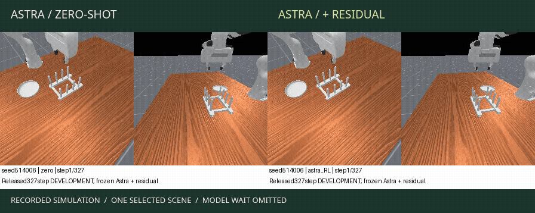

# Astra Control Lab

Robot manipulation experiments with Astra-generated action trajectories in COLOSSEUM V2 and RLBench. The work tests learned trajectory corrections and an action–observe loop, with an Astra-authored drawer controller included as a separate training reference.

You can inspect recorded rollouts, recompute the results, and replay the residual-policy updates with Python's standard library. Running new robot episodes requires the original simulator setup and model access; neither is included here.

[Four-method view](https://pscyk.github.io/astra-control-lab/?view=overview#replay) · [Action–observe demo](https://pscyk.github.io/astra-control-lab/?view=drawer#replay) · [Research findings](RESEARCH.md)

[](https://pscyk.github.io/astra-control-lab/)

The clip shows seed `514006`, where the residual succeeds and the base trajectory fails. It omits model wait and holds the shorter recording's final frame. The demo also includes a regression, a missed grasp, and a drawer recovery using new observations. These are selected examples, not a random sample.

The page opens with all four methods side by side on desktop. Those recordings use different tasks and seeds; they are not a matched four-way comparison. The paired views retain the within-study comparisons, and the results section keeps each study separate.

## Run locally

Use Python 3.10 or later. The main package needs no third-party libraries, GPU, or API key.

```bash
git clone https://github.com/pscyk/astra-control-lab.git
cd astra-control-lab
python3 -m astra_lab verify
python3 -m astra_lab report
python3 -m astra_lab replay-training
python3 -m astra_lab refine-example
python3 -m unittest discover -s tests -v
```

`verify` checks the exported file hashes. `report` calculates completion rates and paired outcomes; `replay-training` recomputes four updates from saved samples and rewards. `refine-example` applies the frozen residual to a recorded trajectory. None of these commands makes a model call or starts a simulator.

To serve the demo locally:

```bash
python3 -m http.server 8000 --bind 127.0.0.1 --directory docs
```

Open `http://127.0.0.1:8000`. The shared controls play or seek all displayed recordings; each video also has independent controls. Dish videos retain their 20 Hz recording rate. Drawer playback does not represent physical execution speed, and neither study's videos include model wait.

The drawer recorder appends ten green status frames after success. Shared playback holds the preceding scene frame instead; the original MP4s and their native video controls retain those status frames.

## Methods

| Method | Model use | Training or feedback | Included here |
|---|---|---|---|
| Zero-shot trajectory | Astra reads observations and returns actions | No task demonstrations in the prompt or base-model weight updates | Recorded actions, input contracts, results, and videos |
| Astra-authored controller | Astra writes Python before execution | The drawer controller reads private simulator state | Original training-only controller, 15 outcome records, and a drawer video |
| Astra + residual RL | Astra supplies the base trajectory | Train three bounded corrections, then freeze them for evaluation | Residual code, policy update, and all four training batches |
| Action–observe loop | Astra receives new observations after short execution phases | Revise actions without changing model weights | Phase rules, feedback contract, results, and drawer videos |

The authored controller is a privileged teacher, so its results do not belong in an observation-only policy comparison. It makes no runtime LLM calls. The residual and feedback loop are separate experiments; this release has no result for a policy that combines them.

“Zero-shot” describes the base model's use of demonstrations and weight updates. The prompts and adapters had development work on these tasks, and inputs include camera calibration and robot state rather than RGB alone.

The historical logs request `gpt-6-astra`. They do not identify an immutable backend checkpoint or establish public access to that model.

## Dish placement results

Status: preliminary. The comparison covers one clean COLOSSEUM V2 task, `PlaceDishInRack-v1`, on 200 planned scenes with seeds `514001` through `514200`. Methods share the initial Astra proposal and per-attempt execution cap. The action–observe follow-up includes one capacity-error retry, so its total attempt cost differs. The policies remain frozen throughout evaluation.

| Method | Completed / planned | Completion rate | 95% Wilson interval |
|---|---:|---:|---:|
| Astra, no correction | 21 / 200 | 10.5% | 7.0–15.5% |
| Astra, action–observe (capacity-recovered) | 32 / 200 | 16.0% | 11.6–21.7% |
| Astra + random-search residual | 58 / 200 | 29.0% | 23.2–35.6% |
| Astra + RL residual | 70 / 200 | 35.0% | 28.7–41.8% |

The RL residual succeeds in 53 scenes where the base fails, but fails in four scenes where the base succeeds. That gives a net gain of 24.5 percentage points. Against random search, it wins 16 pairs and loses four, a net gain of 6 points. Random search accounts for much of the improvement over the base.

There are 34 shared model deadlines. They count as noncompletion within the budget; their physical outcomes remain unknown. One completed proposal fails validation before execution. The remaining 165 scenes produce 495 native rollouts across the three methods. The reported rates retain all 200 planned scenes.

The model deadline is 720 seconds, and execution has a cap of 327 native steps at 20 Hz. Success means satisfying the simulator's native predicate, which does not certify safe contact or insertion into a particular rack slot.

The action–observe follow-up completed on 19 October 2026. All 165 eligible episodes passed audit; all 200 assignments remain in the denominator. The loop repairs 13 base failures and loses two base successes. Its 16.0% completion rate remains below both residual methods. It requests new observations at 64-step intervals and allows up to four feedback calls within the 327-step attempt cap. One capacity-interrupted episode was retried with user approval and succeeded. The interrupted attempt is retained; this is a post-hoc, capacity-recovered comparison, not the original no-retry protocol. [Results, protocol, and commands](DISH_LOOP.md).

The residual uses one training seed. The intervals measure uncertainty across these scenes, not variation across training runs. This study supplies no full-suite COLOSSEUM score, bimanual result, or basis for a state-of-the-art claim.

## Residual training

The policy applies a correction after a closed-gripper rotation followed by a later translation. It modifies the rest of the trajectory with world-frame roll, Y, and Z offsets while retaining the original gripper commands and step budgets.

```text
latent → tanh → [roll × 0.7 rad, Y × 0.08 m, Z × 0.08 m]
```

The frozen policy adds about `0.209 rad` of roll, `7.52 mm` in Y, and `48.74 mm` in Z. Four batch-standardized Gaussian policy-gradient updates produce these values, using eight recorded returns per update. The random-search control receives the same 32 exploration evaluations and shares the first eight samples. Both methods also use a shared zero-residual baseline.

Training rewards use simulator object state. Evaluation receives no such diagnostics, and Astra's weights remain unchanged throughout. There is no behavior-cloned student or online weight update during evaluation.

A placement correction cannot recover an object that the robot never grasped. The saved runs also show that applying the same correction can spoil a successful base trajectory. [RESEARCH.md](RESEARCH.md) examines both failures and proposes tests for selective correction.

## Authored-controller results

Status: preliminary. The archived OpenDrawer evaluation records 15 native successes in 15 scenes: seeds `9400` through `9404`, each with three variations. It uses 120 native commands and no runtime LLM calls. The exporter checks each recorded outcome against returned native rewards and binds the controller source by SHA-256.

The controller reads private simulator state. Its 15/15 result therefore does not rank it against the observation-based methods. [Controller records](docs/data/teacher.json) retain each seed, variation, command count, and source hash.

## Action–observe results

Status: preliminary. This separate RLBench study reuses each exact initial one-shot proposal, then asks Astra for revised actions after short execution phases. Open-gripper phases have at most three waypoints; closed-gripper phases have one. A gripper transition ends the phase.

| Fresh development scene | One-shot | Action–observe |
|---|---|---|
| OpenDrawer | Failure | Success |
| InsertOntoSquarePeg | Success | Success |
| StackCups | Failure | Failure |
| Total | 1 / 3 | 2 / 3 |

The loop also fails on all three previously diagnosed failure scenes. Its fresh drawer recovery uses eight extra calls after the shared first proposal. Across nine new rollouts, the study makes 71 new model calls with a median wait of 18.60 seconds per call. That latency rules out a real-time-control claim for this implementation.

The comparison changes the prompt and depth feedback as well as the call count. The drawer's first returned observation is not bitwise identical between methods. These differences, along with the small sample, prevent a general improvement claim. No RL updates occur in the loop.

## Reproduction status

The public files reproduce the reported counts and confidence intervals from saved records, plus the four training updates. A local numerical check compared the standard-library residual with the original NumPy/SciPy implementation on 165 saved trajectories at three latent settings. The maximum target-coordinate difference was `2.22e-16`.

These checks do not independently reproduce simulator outcomes. The complete native harness, simulator assets, and model access are absent. The export script requires the original research archive, although the public demo and result checks work without it. File hashes detect changes to the exported evidence; they cannot verify how the experiment ran.

See [VALIDATION.md](VALIDATION.md) for the checks and commands used for this release.

## Files

| Path | Contents |
|---|---|
| `astra_lab/residual.py` | Residual transform and policy update using the standard library |
| `astra_lab/feedback.py` | Extracted action-phase and terminal rules |
| `astra_lab/evidence.py` | Assignment checks, paired counts, intervals, and file hashes |
| `docs/` | Static demo; no build step or external scripts |
| `docs/data/` | 600 assignments, training samples, contracts, and source hashes |
| `docs/media/` | Simulation recordings and derived previews |
| `reference/` | Historical controller and residual code; requires optional simulator dependencies |
| `tests/` | Unit tests and an optional browser smoke test |
| `scripts/export_evidence.py` | Selected-field export from the original research archive |
| `RESEARCH.md` | Findings, failure cases, and proposed experiments |
| `VALIDATION.md` | Release checks and exact commands |

## Credits

The experiments use [COLOSSEUM V2](https://github.com/jstmn/ColosseumV2), [ManiSkill](https://github.com/haosulab/ManiSkill), and [RLBench](https://github.com/stepjam/RLBench). [NOTICE](NOTICE) describes the code and asset terms.
